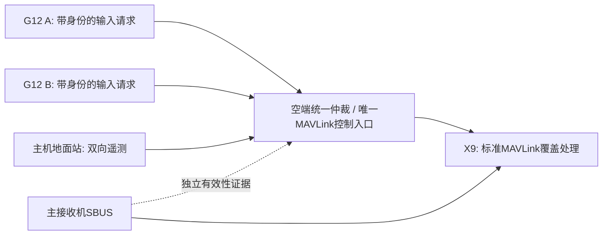

# 跨设备独占控制：实验原型与实施边界

`core/ControlSession` 的静态 OWNER 只排除同一 Java 进程内的重复接管。两个 G12、两个应用进程、主机地面站不会共享此锁。飞控的 sysid 白名单也没有给某个发送端授予独占权。

`lab/arbiter.py` 提供一个独立单写者原型：不同设备用各自临时 HMAC-SHA256 密钥签署受限四轴请求；仲裁端验证身份、启动 nonce、租约代次、递增序号、输入范围、deadman、模拟源时间，再生成允许的控制输出。客户端不能提交任意 MAVLink 或远程 grant/reset/release 命令。租约由可信本地操作者显式发放；首帧中位/低油门；输入150ms失效、目标1500ms失效、实验租约2s到期均锁存停止。停止后需要重新确认、目标证据和明确发放，重连/进程重启不自动恢复。成功交还后也不自动重取。

`lab/test_arbiter.py` 启动两个独立 OS 子进程；每个仅持有自己的临时密钥，经独立 IPC 向同一仲裁实例提交请求。测试逆序交付两端请求、重复grant、伪造、重放、过期代次、重启nonce、源停滞、时间倒退、输出失败和主机证据过期。密钥只驻留测试内存，未写文件。它验证了多个进程请求经过同一权威时的排他性；不是两台真机的网络/时钟测试。

## 真实部署必须具备的权威位置

该图是待选定的拓扑，不宣称现有 GR00/X9 已实现。需要在所有 MAVLink 控制入口汇合处设置可强制执行的入口（例如独立空端网关）；透传遥测必须保留，但不能允许主串口、备用串口、USB或其他GCS绕过控制授权。主 SBUS 仍直接承担正常 RC，不能改成第二 SBUS 接收机。未经仲裁的 COMMAND_LONG、模式/任务等也可能改变控制，生产版需要完整消息权限策略，不能仅过滤69/70两类消息。原型不代理任意遥测，也未开放硬件端口。

若仍让两个数传串口直接进入原版飞控，应用互相通告“我已接管”无法强制排他。MAVLink signing 可以帮助认证/抗重放，但共享签名密钥和相同sysid不是独占租约，不能阻止有权发送端争抢。若要求不用额外网关而由飞控强制仲裁，需要另立、单独审核的固件分支；本项目未修改飞控。

## 不应混淆的证据

| 观察 | 可以说明 | 不能说明 |
|---|---|---|
| HMAC正确 | 测试设备持有对应密钥、请求未改动 | 摇杆硬件确实刚采样；设备未故障/被攻陷 |
| 应用回调刚到 | Android收到了回调 | 回调内容未缓存/重播 |
| `source_ms/source_valid` | 本实验共享时钟上的合成输入证据 | 已解决两台真实设备的时钟同步/可信采样 |
| RC_CHANNELS出现请求值 | 飞控当前采用该输入值 | 哪个发送端独占、原始SBUS健康、控制权ACK |
| 收到HEARTBEAT和UID | 对象/固件匹配检查 | 密码学可信身份 |
| 发出release | 请求撤销本方覆盖 | 主SBUS已恢复或操作者已准备 |

真实输入需要厂商定义的采样计数/时间与有效/失联语义，以及认证链路和重连清队列。时间同步误差上限、挑战应答或源端看门狗需另行设计；不能直接照搬实验的共享 `monotonic` 时钟。应用/网关恢复不能续用旧授权。

主链路确认必须来自未被MAVLink覆盖污染的独立观察或硬件门控，并包含操作者确认。原型中只有可信lab调用可以提交primary证据；SITL生产者的状态不能替代真实SBUS接收器的frame-lost/failsafe标志。主链路证据不足时不发送释放，停止本方刷新并等待飞控既有超时/failsafe。

最后一帧覆盖会在飞控内部继续有效至 RC_OVERRIDE_TIME 到期。应用150ms停止不等于飞控150ms撤销；默认3s时必须将这段保持纳入系统风险分析。不得为缩短测试而关闭failsafe、围栏或安全检查。

实验还没有生产级密钥供应/撤销、安全存储、认证操作界面、HA网关、防DoS、跨机器协议传输或租约续期。不能将此 Python 原型直接部署为飞行控制网关。
